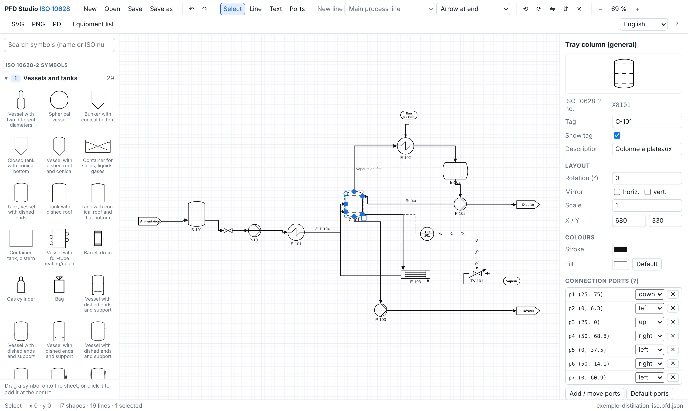

# PFD Studio

**A free, offline editor for process flow diagrams with the complete ISO 10628-2 symbol library.**

**Use it online:** https://vthielens.github.io/pfd-studio/ (nothing to install, works in Chrome, Edge and Firefox)

PFD Studio lets students, teachers and engineers draw process flow diagrams (PFD) and simple P&IDs
with the graphical symbols of **ISO 10628-2:2012**, without a CAD licence and without an Internet connection.
The interface is available in **English**, **French** and **Dutch**.

## Features

- **295 ISO 10628-2 symbols** in the 29 groups of the standard (vessels, columns, heat exchangers, pumps,
  compressors, valves, filters, centrifuges, dryers, mixers, conveyors…), each with its ISO registration number.
  Search by name in any of the three languages or by ISO number (e.g. `2322`, `X8101`).
- **Connection ports** on every symbol, taken from the preferred connection points of the standard.
  Add, move or delete ports on any symbol with the *Ports* tool.
- **Attached lines and arrows**: draw from port to port; lines follow when equipment is moved, rotated or mirrored.
  Orthogonal routing, waypoints, eight line types (process, secondary, dash-dot, utility, signal,
  electrical, pneumatic, data), arrowheads and line labels.
- **Automatic equipment tags** per ISO group (B-101, C-101, E-101, P-101…), free texts.
- **Sheet frame and title block** (A4 to A1, portrait or landscape).
- **Export** to SVG (opens in Inkscape), PNG, PDF and a CSV **equipment list** for Excel.
- Undo/redo, copy/paste, multiple selection, alignment, autosave in the browser, files in plain JSON (`.pfd.json`).
- No installation, no server, no account: everything runs in the browser and stays on your computer.

## Getting started

**Online:** open https://vthielens.github.io/pfd-studio/.

**Offline:** download the latest [release](../../releases) (or *Code > Download ZIP*), unzip it and
double-click `index.html`. Chrome or Edge are recommended: *Save* then writes directly to your file.

Then:
1. Drag equipment from the library onto the sheet.
2. Hover a symbol to see its ports; drag from one port to another to create an attached line.
3. Press **?** or **F1** in the app for all keyboard shortcuts.

Two examples are included: `exemple-distillation-iso.pfd.json` (ISO symbols) and `exemple-distillation.pfd.json`.
A French manual is in [LISEZMOI.md](LISEZMOI.md).

### Hosting your own copy

PFD Studio is a static website (HTML, CSS, JavaScript, no database). To host it on a university or company
web server, copy `index.html`, `css/`, `js/` and the example files to any web folder.

## How to cite

If you use PFD Studio in teaching or research, please cite it. GitHub shows a ready-made reference under
**"Cite this repository"** (from [CITATION.cff](CITATION.cff)). Each release is archived on Zenodo with a DOI.

> Thielens, V. (2026). *PFD Studio: an offline editor for process flow diagrams with the ISO 10628-2 symbol library* (Version 1.0.0) [Computer software]. Zenodo. https://doi.org/10.5281/zenodo.24587029

## Development

- No build step: edit the files in `js/` and `css/` and reload `index.html`.
- Tests: `npm install`, `npx playwright install chromium`, `npm test` (also run on every push by GitHub Actions).
- The ISO symbol file is generated reproducibly from the source sheets: see [tools/iso-symbols](tools/iso-symbols/README.md).
- Contributions, bug reports and questions: see [CONTRIBUTING.md](CONTRIBUTING.md). Changes are listed in [CHANGELOG.md](CHANGELOG.md).

| File | Content |
|------|---------|
| `index.html` | Application page |
| `js/app.js` | Editor (rendering, ports, routing, files, export) |
| `js/iso-symbols.js` | ISO 10628-2 symbols (generated, CC BY-SA 4.0) |
| `js/symbols.js` | Categories, instrumentation and boundary symbols |
| `js/i18n.js` | Interface texts in English, French and Dutch |
| `css/app.css` | Appearance (the symbol line weight is `--sym-sw`) |

## Licences and credits

- **Application code:** GNU General Public License v3.0 or later ([LICENSE](LICENSE)).
- **ISO 10628-2 symbol data** (`js/iso-symbols.js`, `tools/iso-symbols/sheets/`, `tools/iso-symbols/tr.py`):
  derived from the *ISO 10628-2:2012 Symbols* sheets by **Steven Baltakatei Sandoval** (2020),
  [Wikimedia Commons](https://w.wiki/dg9), licensed [CC BY-SA 4.0](https://creativecommons.org/licenses/by-sa/4.0/).
  Changes: automatic extraction, connection ports, scaling, uniform line weight, French and Dutch names.
  Distributed under the same licence ([LICENSES/CC-BY-SA-4.0.md](LICENSES/CC-BY-SA-4.0.md)).
- ISO 10628 is a standard of the International Organization for Standardization. This project is not affiliated
  with or endorsed by ISO and does not reproduce the text of the standard. Always check symbols against your copy of the standard.
- French and Dutch symbol names are the author's translations, not the official national versions of the standard.
